<p align="center">
  
</p>

<h1 align="center">espFace</h1>

<p align="center">
  <b>Your ESP32 describes its UI. The apps draw it.</b><br>
  An Arduino library, a native app and a web renderer that share one small JSON protocol.<br>
  No web code, no app code, no cloud.
</p>

<p align="center">
  <a href="https://espface.manzari.dev">Website</a> ·
  <a href="https://espface.manzari.dev/docs/guide/getting-started.html">Getting started</a> ·
  <a href="https://espface.manzari.dev/docs/guide/widgets.html">Widget catalogue</a> ·
  <a href="https://espface.manzari.dev/docs/reference/espface.html">API reference</a> ·
  <a href="protocol/PROTOCOL.md">Protocol</a> ·
  <a href="CHANGELOG.md">Changelog</a>
</p>

<p align="center">
  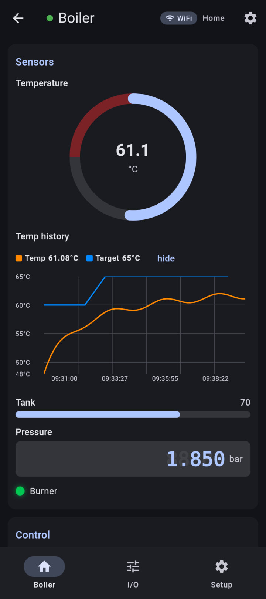
  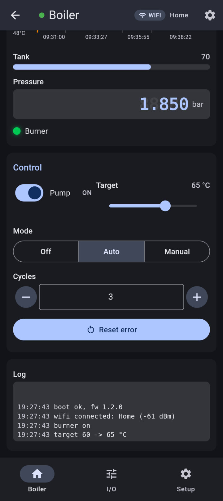
  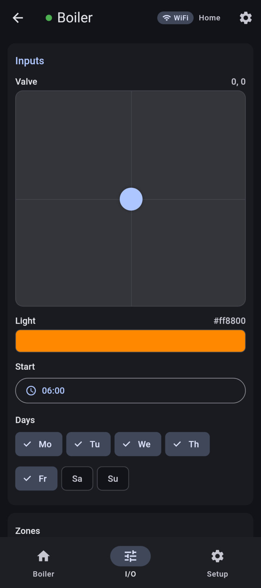
</p>

## The firmware is the app

The device describes its own screen. A sketch declares widgets with the espFace library and gets a callback when a value changes. The app and any browser draw that description and talk straight to the device. There is no app to write, no HTML to serve by hand and no layout to maintain.

```cpp
#include <espFace.h>

EspFace face;
const int PUMP = 26;
float target = 60;

void setup() {
  pinMode(PUMP, OUTPUT);
  face.begin("Boiler");
  face.setPin("1234");                 // optional: clients pair with a PIN
  face.wifi().autoConnect();           // stored network, else a setup access point

  Ui& ui = face.ui();
  ui.gauge("temp", "Temperature", 0, 120, "°C").zone(90, 120, "#ff0000");
  ui.chart("hist", "Temp history", 600, "°C").series("temp", "Temp", "#ff8800");
  ui.sw("pump", "Pump").onChange([](bool on) { digitalWrite(PUMP, on); });
  ui.slider("target", "Target", 20, 90, 1, "°C").persist().bind(target);
}

void loop() {
  face.loop();
  static uint32_t last = 0;
  if (millis() - last >= 1000) {
    last = millis();
    float t = temperatureRead();       // chip sensor, stands in for yours
    face.set("temp", t);
    face.push("hist", "temp", t);
  }
}
```

Flash it, open the espFace app or `http://<device-ip>/` in a browser, enter the PIN once, and the gauge, the chart, the switch and the slider are there. The slider value survives a reboot (`persist()`) and is mirrored into `target` (`bind()`).

## Features

- **30 widget types.** Gauges, charts, LEDs, switches, sliders, joysticks, colour and time pickers, tables, logs, camera streams and maps, arranged in pages, groups and rows.
- **Native app and web renderer.** A Flutter app and a Preact renderer draw the same description. The device serves the renderer from its own flash (about 60 KB gzipped), so the browser UI works without internet.
- **Four transports.** WiFi WebSocket, Bluetooth LE, USB or UART serial and Bluetooth Classic SPP share one session layer. Each one is a single call to add.
- **PIN pairing without TLS.** An HMAC-SHA256 challenge-response keeps the PIN off the wire. Clients get a session token per device, and five wrong tries lock pairing out.
- **System pages included.** WiFi provisioning with a captive portal, firmware updates over the air, NTP, ntfy notifications, device info, reboot and PIN change.
- **No cloud, no account.** The phone talks straight to the device. No server in between, no sign-up, no analytics, no ads.
- **Small.** The `Minimal` example adds about 117 KB of flash and 1.1 KB of static RAM on an ESP32, renderer included.

## Widgets

<table>
  <tr>
    <td align="center">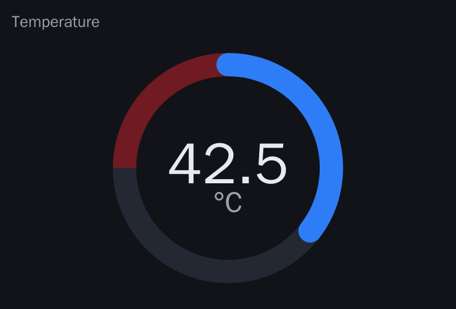<br><code>gauge</code></td>
    <td align="center">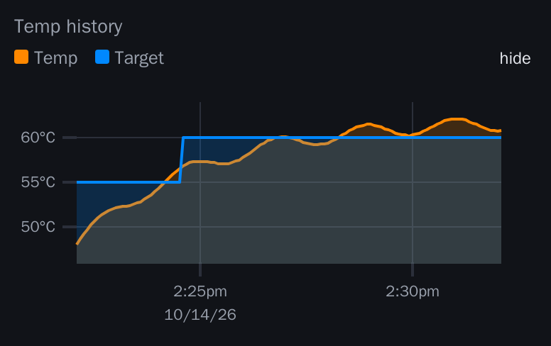<br><code>chart</code></td>
    <td align="center">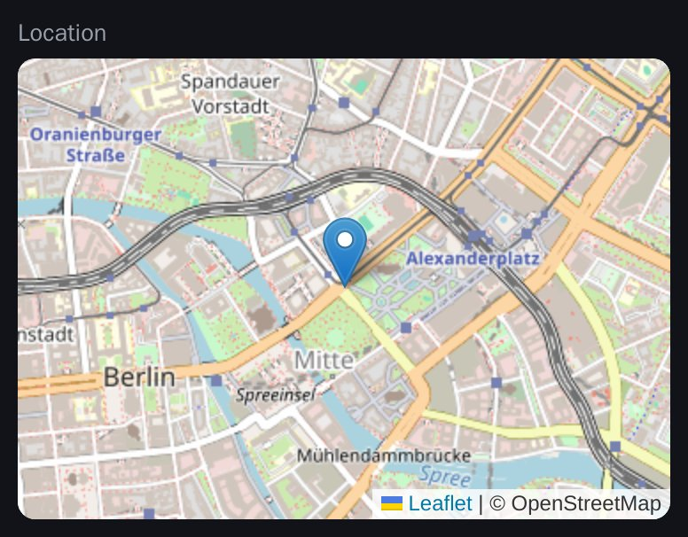<br><code>map</code></td>
  </tr>
  <tr>
    <td align="center">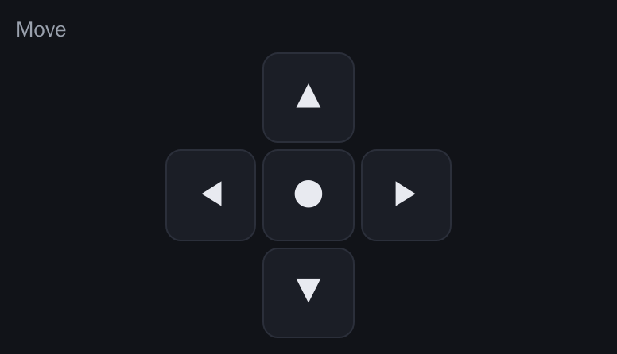<br><code>dpad</code></td>
    <td align="center">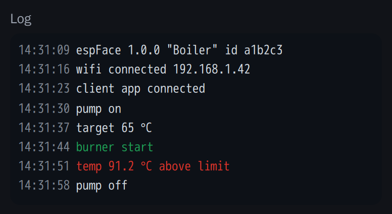<br><code>log</code></td>
    <td align="center">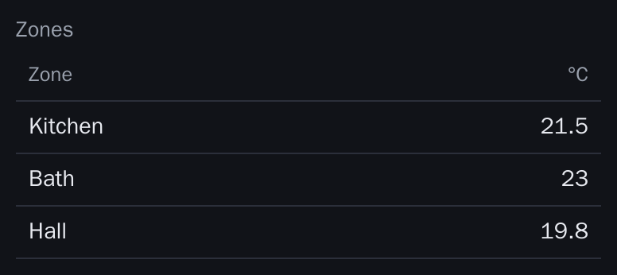<br><code>table</code></td>
  </tr>
  <tr>
    <td align="center">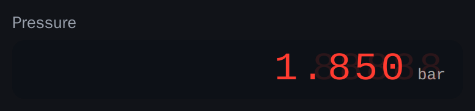<br><code>display</code></td>
    <td align="center">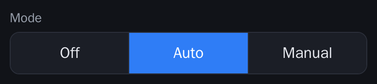<br><code>select</code></td>
    <td align="center">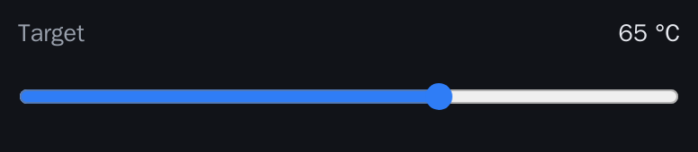<br><code>slider</code></td>
  </tr>
</table>

| Kind | Types |
|---|---|
| Output | `label` `gauge` `progress` `display` `led` `chart` `log` `table` `clock` `map` `image` `stream` `textblock` |
| Input | `button` `switch` `slider` `number` `text` `textarea` `select` `flags` `color` `datetime` `joystick` `dpad` |
| Layout | `page` `header` `group` `row` `spacer` |

Every type with its props and an example is in the [widget catalogue](https://espface.manzari.dev/docs/guide/widgets.html).

## One app for every device

<p align="center">
  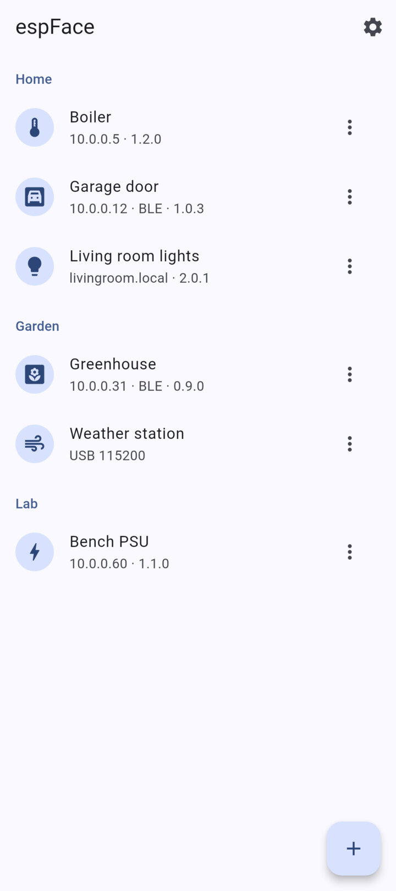
  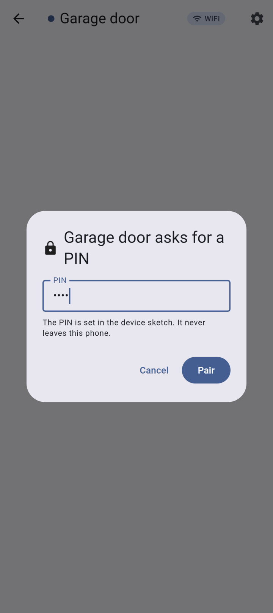
</p>

The app finds devices through mDNS, a Bluetooth scan or a plugged-in USB adapter, and you can add one by IP address or QR code. It groups devices by project and keeps the pairing, so the PIN is asked once. It runs on Android 7.0 and later and comes from the F-Droid repository linked on the [website](https://espface.manzari.dev/#download). The iOS target is in the tree and has no store release yet.

## No app needed

<p align="center">
  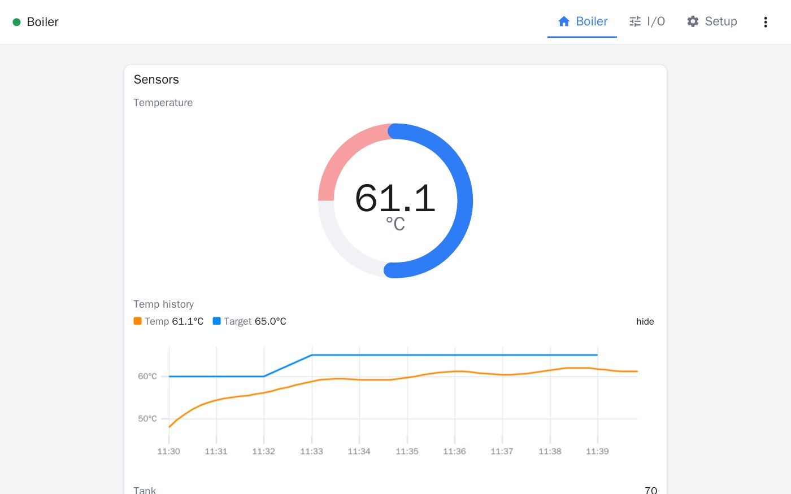
  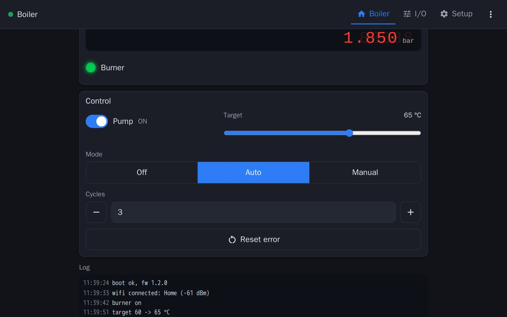
</p>

A device on WiFi also serves its screen as a web page. Open its address in any browser on your network: same widgets, same PIN pairing, nothing to install.

## How it works

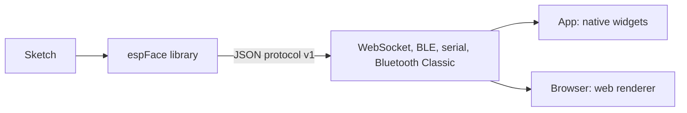

The protocol is the single source of truth. `protocol/` holds the specification, a JSON Schema and test vectors, and the firmware, the web renderer and the app are all tested against them. Every side ignores keys, message types and widget types it does not know, so an older client keeps working with newer firmware.

## Quick start

You need an ESP32, S2, S3, C3 or C6 board, the Arduino ESP32 core 3.x and ArduinoJson 7. ESP8266 is not supported.

**1. Get the library.** It is the `firmware/` directory of this repository.

- PlatformIO: clone the repository and point `lib_deps` at the checkout.

  ```ini
  lib_deps =
    symlink:///path/to/espFace/firmware
    bblanchon/ArduinoJson@^7.0.0
  ```

- Arduino IDE: copy or symlink `firmware/` to `<sketchbook>/libraries/espFace` and install ArduinoJson 7 through the Library Manager.

Registry packages named `espFace` for the Arduino Library Manager and PlatformIO are part of the release steps in [`docs/RELEASE.md`](docs/RELEASE.md).

**2. Flash a sketch.** Start with the code above or with one of the examples in [`firmware/examples`](firmware/examples): `Minimal`, `FullDemo`, `Notify`, `SerialOnly`, `BleOnly`, `Provisioning` and `BtClassic`.

**3. Open the UI.** A board without stored WiFi credentials opens the access point `espFace-<id>` with a captive portal for the setup. After that the app finds the device on its own, and a browser reaches it at `http://<device-ip>/`.

The [getting started guide](https://espface.manzari.dev/docs/guide/getting-started.html) covers each step in detail.

### Try it without hardware

The fake device is a Node implementation of the device side with every widget type on three pages. Run it next to the renderer, each in its own terminal:

```sh
docker build -f docker/fake-device.Dockerfile -t espface-fake . && docker run --rm -p 18080:8080 espface-fake --pin=1234
docker build -f server/renderer/Dockerfile -t espface-renderer . && docker run --rm -p 8081:80 espface-renderer
```

Then open `http://localhost:8081/connect/?host=localhost:18080` and pair with the PIN 1234.

## Documentation

| Topic | Where |
|---|---|
| Getting started | [guide/getting-started](https://espface.manzari.dev/docs/guide/getting-started.html) |
| Pages, groups, rows, values, persistence | [guide/concepts](https://espface.manzari.dev/docs/guide/concepts.html) |
| Transports: WiFi, BLE, serial, Bluetooth Classic | [guide/transports](https://espface.manzari.dev/docs/guide/transports.html) |
| WiFi provisioning, OTA, NTP, ntfy | [guide/system](https://espface.manzari.dev/docs/guide/system.html) |
| Security model | [guide/security](https://espface.manzari.dev/docs/guide/security.html) |
| Mobile app, web renderer | [guide/app](https://espface.manzari.dev/docs/guide/app.html), [guide/web](https://espface.manzari.dev/docs/guide/web.html) |
| API reference, compile-time options | [reference/espface](https://espface.manzari.dev/docs/reference/espface.html), [reference/options](https://espface.manzari.dev/docs/reference/options.html) |
| Protocol v1 | [`protocol/PROTOCOL.md`](protocol/PROTOCOL.md) |
| FAQ and troubleshooting | [guide/faq](https://espface.manzari.dev/docs/guide/faq.html) |

## Repository

```
protocol/           JSON schema v1, test vectors, validator
firmware/           Arduino library
web/                TypeScript renderer (Preact)
apps/mobile/        Flutter app
tools/fake-device/  Node reference implementation of a device
server/renderer/    nginx image: renderer + flash page
docs/site/          VitePress docs site, API reference generated from the firmware headers
promo/              landing page for the app, serves the docs
docker/             build and run images
```

Each component has its own README. The design rationale is in [`docs/PLAN.md`](docs/PLAN.md), the release steps are in [`docs/RELEASE.md`](docs/RELEASE.md).

## Development

Everything runs in Docker, so the host needs nothing but Docker. Run these from the repository root.

```sh
# protocol: schema and vectors
docker run --rm -v "$PWD":/w -w /w/protocol node:22-alpine sh -c "npm ci && npm test"

# firmware: native unit tests
docker build -f docker/platformio.Dockerfile -t espface-pio . && docker volume create espface-pio
docker run --rm -v "$PWD":/w -v espface-pio:/pio -w /w/firmware espface-pio test -e native

# web renderer: build with the size gate, then the tests
(cd web && scripts/node.sh npm ci && scripts/node.sh npm run build && scripts/node.sh npm test)

# mobile app: build the image once, then analyze and test
docker build -f docker/flutter.Dockerfile -t espface-flutter docker
(cd apps/mobile && export FLUTTER_IMAGE=espface-flutter && scripts/flutter.sh pub get && scripts/flutter.sh analyze && scripts/flutter.sh test)

# fake device on ws://localhost:18080/ws (host port 8080 is often taken); hardening knobs see tools/fake-device/README.md
docker build -f docker/fake-device.Dockerfile -t espface-fake . && docker run --rm -p 18080:8080 espface-fake --pin=1234

# docs site
docker run --rm -u "$(id -u):$(id -g)" -e HOME=/tmp -v "$PWD":/w -w /w/docs/site node:22-alpine sh -c "npm ci && npm run build"

# renderer + flash image (what Coolify deploys at r.espface.manzari.dev), http://localhost:8081/
docker build -f server/renderer/Dockerfile -t espface-renderer . && docker run --rm -p 8081:80 espface-renderer

# landing page + docs preview on http://localhost:8888 and /docs/ (placeholder privacy policy and terms)
docker build --build-arg ALLOW_PLACEHOLDER_LEGAL=1 -f promo/Dockerfile -t espface-promo . && docker run --rm -p 8888:80 espface-promo
```

The ESP32 build matrix, the end-to-end tests and the CI jobs are described in [contributing and CI](https://espface.manzari.dev/docs/guide/contributing.html).

## Landing page

`promo/` is the landing page at `https://espface.manzari.dev`, built by the apppage engine, a copy of which is in `promo/engine`: texts in `promo/i18n/en.yml`, links and Impressum data in `promo/_config.yml`, colours in `promo/brand.css`, and the privacy policy and terms from `promo/engrossify.yaml`. `promo/compose.yaml` is the Coolify deployment (base directory `/promo`, build context the repository root) and names the one secret its build needs. The same image builds the docs site from `docs/site` and serves it at `https://espface.manzari.dev/docs/` (`promo/docs.conf`). The renderer and the flash page are on `https://r.espface.manzari.dev`; `promo/renderer-host.conf` redirects their old paths on the landing page host, which firmware 1.0.0 depends on for `/r/1/`.

The images in `promo/images` are generated: `apps/mobile/scripts/promo-shots.sh` renders the app's screens in widget tests, `web/scripts/promo-shots.sh` the renderer in a desktop browser.

## Status

Version 1.0.0. Protocol v1 is stable and the renderer path `/r/1/` is frozen ([`web/RENDERER-VERSIONING.md`](web/RENDERER-VERSIONING.md)). All components share one version number. The ESP32, S2, S3, C3 and C6 builds are compile-checked in CI; not every chip has been tested on hardware.

## License

MIT, see [`LICENSE`](LICENSE). Bundled third-party code keeps its own license: `apps/mobile/third_party/usb_serial` is BSD-licensed (see its `LICENSE`), and the icons are a subset of Material Icons under the Apache License 2.0.

## Contact

Questions, bug reports and patches are welcome at [mail@manzari.dev](mailto:mail@manzari.dev).
